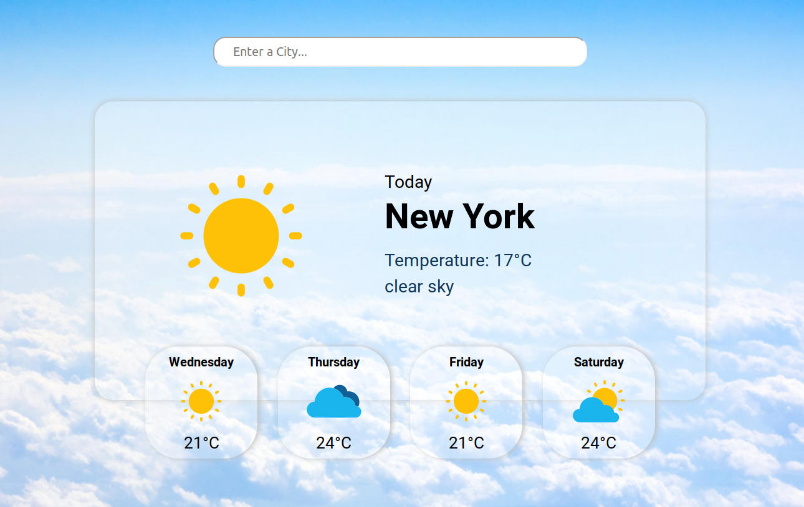

# Weather Forecast App

Built with React. Uses OpenWeatherMap's API. Deployed via Netlify [here](https://alexkowsik-weather-app.netlify.com/).

# Weather Forecasting App ☀️🌧️

A simple weather forecasting application that shows real-time weather
information for any city using a weather API.

---

## Features
- Search weather by city name
- Displays temperature, humidity, and weather conditions
- Real-time weather data
- Clean and user-friendly interface

---

## Technologies Used
- HTML
- CSS
- JavaScript
- Weather API (OpenWeatherMap)

---

## How to Run the Project
1. Clone the repository
2. Open `index.html` in a web browser
3. Enter a city name to view the weather details

---

## Future Improvements
- Add 7-day weather forecast
- Add location-based weather
- Improve UI design

---

## License
MIT License
